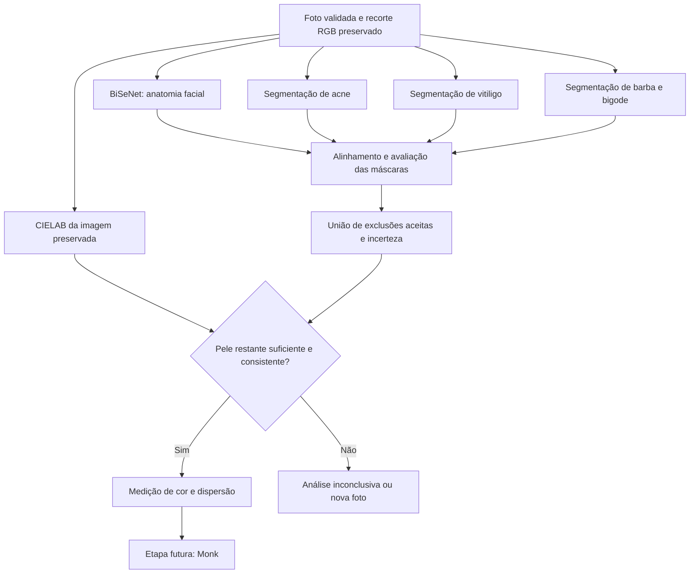

# Plano: seleção independente de pele antes da medição de cor

Atualizado em **15/10/2026**. Planejamento; nenhuma etapa abaixo foi implementada nesta revisão. Candidatos, fontes, disponibilidade e tradeoffs estão em [PESQUISA_CONDICOES_PELE.md](PESQUISA_CONDICOES_PELE.md).

**Implementação posterior em 15/10/2026:** o backend foi integrado conforme
[skin_selection/README.md](../backend/src/skin_selection/README.md), usando
**YOLOv8l-seg de prashants975 para barba/bigode por decisão do usuário**, substituindo
o EasyPortrait. Veja [a implementação adotada](DETECCAO_BARBA.md).
Frontend integrado com máscaras e estados por categoria. Há inferência, máscaras, qualidade, API, testes
e ferramenta de avaliação offline; anotação do piloto, calibração e validação
das três capacidades ainda são necessárias para cumprir a condição de
conclusão deste plano. O plano abaixo reflete o escopo atual.

## Objetivo e escopo fechado

Preservar o BiSeNet atual e entregar uma máscara confiável para medir a cor, excluindo:

1. Acne.
2. Vitiligo.
3. Barba e bigode.

Rosácea não terá detector, mapa de vermelhidão difusa ou cartão de resultado. Maquiagem não terá módulo próprio.

A saída desta fase alimentará a medição de cor e, depois, Monk. Não inclui implementar a conversão para Monk ou o recomendador de bases.

## Fluxo de execução pretendido



As ramificações representam independência dos dados, não obrigação de executar redes em paralelo. Começar sequencialmente em CPU, medindo RAM e latência. Paralelização poderá aumentar competição por threads e memória.

1. Guardar o recorte RGB antes da redução para 512 que hoje ocorre em `analysis_events()`. A imagem já passou pelo limite global de 1600 do upload; manter esse limite inicialmente.
2. BiSeNet e especialistas recebem vistas preparadas do mesmo RGB. Cada adaptador guarda escala, padding e eventual alinhamento/inversa. Nenhum recebe o resultado com exclusões pintadas de preto.
3. Mapear todas as máscaras para o recorte preservado. Reamostrar probabilidades antes de aplicar limiar; usar vizinho mais próximo para rótulos. Conferir ordem dos canais e classes por modelo.
4. Obter máscaras aceitas e incertezas dos especialistas. Restringir o efeito sobre a medição à anatomia candidata, preservando previsões externas para depuração. BiSeNet permanece o limite inicial: pele que ele perdeu não será recuperada silenciosamente.
5. Compor a seleção, verificar qualidade e medir cor nos pixels originais selecionados. O overlay é somente visualização, nunca entrada da medição.

## Contrato interno proposto

Todas as máscaras possuem forma `(H, W)` e o mesmo referencial do recorte. Nomes abaixo são proposta para implementação:

```python
selection = {
    "anatomical_mask": ...,       # bool: pele/nariz do BiSeNet
    "accepted_masks": {
        "acne": ...,
        "vitiligo": ...,
        "barba": ...,
    },
    "uncertain_mask": ...,        # bool: regiões ainda ambíguas
    "excluded_mask": ...,         # união aceita, limitada à anatomia
    "valid_mask": ...,            # anatomia - exclusões - incerteza
    "module_status": ...,         # execução e disponibilidade por módulo
    "regions": ...,               # motivo, bbox, área, evidências e origem
    "quality": ...,               # cobertura, dispersão, decisão e razões
    "model_versions": ...,        # versão, checksum, pré/pós-processamento
}
```

Regras:

- `excluded_mask = anatomical_mask & union(accepted_masks.values())`.
- `valid_mask = anatomical_mask & ~excluded_mask & ~uncertain_mask`.
- Máscaras de motivos podem se sobrepor. Contar a união uma vez; percentuais por motivo não são somáveis. Se a UI exigir uma cor única por pixel, uma prioridade visual não apaga os motivos originais.
- Resultado vazio de um modelo executado é diferente de modelo indisponível, não executado ou falha de inferência. Não converter esses estados em “não detectado”.
- `confidence` de rede não equivale a certeza clínica. Preservar origem da evidência: modelo específico ou discordância entre parsers.
- Barba usa a classe explícita `beard` do YOLOv8l-seg; cabelo (`hair`) é ignorado. Não há mais exclusão por discordância entre parsers.

## Etapas de desenvolvimento e critérios de saída

| Etapa | Trabalho e entrega | Critério para avançar | Esforço relativo |
|---|---|---|---|
| 0. Referência de avaliação | Selecionar fotos e anotar máscaras de pele utilizável/exclusões; fixar divisão por pessoa. | Haver casos positivos, negativos e confusores para os três grupos. | Médio; depende de dados. |
| 1. Infraestrutura de máscaras | Preservar resolução, transformações, contrato, composição e prévias. Usar máscaras controladas em testes. | Alinhamento e união corretos, sem alterar RGB de medição; falhas explícitas. | Baixo a médio. |
| 2. Acne | Executar U-Net no ambiente original; comparar máscaras, calibrar e exportar se viável. | Ganho sobre BiSeNet e baseline; falsos positivos e custo aceitáveis. | Médio. |
| 3. Vitiligo | Avaliar `vitiligon-seg.pt` em faces, negativos e iluminação desigual; auditar classes e máscaras. | Localização facial útil, referência restante adequada e identidade do peso esclarecida. | Médio a alto/incerto. |
| 4. Barba | YOLOv8l-seg de prashants975, classe `beard`, exportado para ONNX. | Barba/bigode identificados sem remover mandíbula inteira; medir qualidade anotada e CPU/RAM. | Integração concluída; validação anotada pendente. |
| 5. Combinação | Calibrar união, áreas ambíguas, margens e qualidade com especialistas juntos. | Ganho mantido na combinação, sem excesso cumulativo de exclusões. | Médio. |
| 6. API e interface | Retirar rosácea do produto, exibir três categorias, disponibilidade e máscaras reais. | Sem marcação fictícia em foto analisada; contratos JSON/NDJSON consistentes. | Médio. |
| 7. Liberação para medição | Congelar versões e validar teste separado, cor e tempo no Windows/CPU. | Só emitir medição utilizável quando a qualidade passar. | Médio. |

Os esforços são estimativas de engenharia, não prazos medidos. As etapas 2–4 têm dependência comum na infraestrutura e podem ser investigadas independentemente.

### Decisões se um candidato falhar

| Problema observado | Próximo passo delimitado |
|---|---|
| U-Net perde acne ou gera muitas exclusões falsas | Comparar SegFormer-B1 nas mesmas fotos. Usar SA-RPN somente se o ganho justificar stack e custo maiores. |
| YOLO de vitiligo não generaliza para rosto | Buscar esclarecimento técnico do peso/dados; avaliar ajuste supervisionado com máscaras faciais. GloW-VSNet só entra após resolver seu contrato de saída. |
| YOLOv8l de barba lento em CPU ou insuficiente em pelos finos/claros | Medir casos reais e avaliar treinamento de variante menor com anotações locais. |
| Bordas locais deixam contaminação | Testar GrabCut/margem local nos candidatos; não aumentar erosão de todo o rosto. |
| Modelo obrigatório indisponível | Informar análise parcial/indisponível e impedir que seja apresentada como seleção completa para Monk. |

Não manter uma investigação indefinida: cada comparação usa o mesmo conjunto e decide entre adoção, ajuste/treino ou capacidade explicitamente indisponível. Uma versão parcial pode servir para desenvolvimento; não é conclusão do escopo completo.

## Integração nos arquivos atuais

Estrutura sugerida:

```text
backend/src/skin_selection/
    contracts.py       # máscaras, transformações e estados
    acne.py            # adaptador do candidato aprovado
    vitiligo.py        # adaptador do candidato aprovado
    beard.py           # máscara específica e eventuais auxiliares
    compose.py         # união, motivos e incerteza
    quality.py         # cobertura e consistência
    pipeline.py        # orquestração desta etapa independente
```

| Arquivo atual | Mudança planejada |
|---|---|
| [segmentation/pipeline.py](../backend/src/segmentation/pipeline.py) | Preservar recorte; incluir seleção entre anatomia e medição; emitir progresso real dos módulos. |
| [segmentation/semantic.py](../backend/src/segmentation/semantic.py) | Manter máscara anatômica separada. Expor probabilidades se necessário. Medição passa a receber `valid_mask` explicitamente ou migra para módulo apropriado. |
| [segmentation/skin.py](../backend/src/segmentation/skin.py) | K-means continua descritivo. Se usado para candidatos, distinguir descritores anteriores das estatísticas finais. Não reativar `grow_skin()` inteiro nem impor grupo dominante/conectividade única. |
| [segmentation/model_asset.py](../backend/src/segmentation/model_asset.py) e [download_model.py](../backend/download_model.py) | Ampliar registro/download explícito de modelos com origem, versão e SHA-256. |
| [mock_analysis.py](../backend/src/mock_analysis.py) | Retirar rosácea e atualizar demonstração para o escopo. Manter separação entre exemplo e saídas reais. |
| [preprocessing.js](../frontend/js/screens/preprocessing.js) e [result.js](../frontend/js/screens/result.js) | Exibir antes/depois, três motivos, qualidade e área utilizada. |
| [processing.js](../frontend/js/screens/processing.js) | Já renderiza lista dinâmica; revisar textos/estados para novas etapas e capacidades indisponíveis. |
| [API.md](API.md) e README | Atualizar contrato, erros, modelos e fronteira entre real/simulado. |

Não importar os apps externos completos: eles trazem servidores, interfaces e dependências desnecessárias. Manter avaliação/conversão PyTorch em ambiente separado. Preferir ONNX Runtime para execução final quando a conversão for equivalente. Carregar sessões uma vez por processo e controlar threads/memória.

A primeira visualização deve usar o próprio recorte para garantir alinhamento. Mostrar máscaras sobre a foto completa só após preservar caixa do rosto e todas as transformações. Percentual de exclusão deve declarar seu denominador: pele anatômica inicial; percentual de pele válida pode ser informado também em relação ao contorno facial.

## Qualidade antes de medir

O código atual verifica pelo menos 64 pixels de pele antes das novas exclusões. Isso não basta para uma amostra de cor confiável. A nova decisão considera:

- Quantidade absoluta de pixels nativos e fração de pele válida; ampliar imagem não aumenta evidência.
- Distribuição em regiões da face e consistência de cor. Uma ilha minúscula não deve definir o tom; exigir várias regiões rígidas também pode rejeitar injustamente casos de vitiligo extenso, portanto calibrar a regra.
- Clipping, nitidez e iluminação desigual; brilho é qualidade da foto, não diagnóstico.
- Diferença da medição usando somente pixels aceitos versus incluindo áreas incertas. Grande mudança exige abstenção/revisão.
- Discordância entre especialistas, referência local insuficiente ou exclusão excessiva.

Fixar limiares a partir da validação, antes de observar o teste final. Registrar razões objetivas do resultado inconclusivo. Não usar a maior região ou o maior cluster como verdade automática, nem reconstruir a cor da pele encoberta.

Para a primeira comparação de seleção, preservar a média Lab existente e calcular também uma estatística robusta e dispersão. Assim é possível separar o efeito da máscara do efeito de trocar o estimador. A escolha do estimador que alimentará Monk será documentada posteriormente.

## Avaliação que decide a implementação

Montar piloto de aproximadamente 100–200 fotos como ponto inicial para encontrar falhas, sem tratar esse tamanho como validação suficiente de todos os grupos. Usar pessoas distintas entre ajuste e teste. Incluir tons claros a escuros, negativos, acne junto a pintas, vitiligo junto a reflexos, barba escura/branca/rala, bigode isolado, tatuagem, delineado, verruga pouco contrastante e piercing vazado. Ter exemplos de condições simultâneas.

Comparações: BiSeNet isolado; cada especialista individual; combinação completa; máscara manual de referência. Avaliar:

| Medida | Pergunta respondida |
|---|---|
| Precisão/recall, Dice/IoU por motivo | A área desejada é localizada? |
| Pele válida removida indevidamente | Qual é o custo dos falsos positivos? |
| Contaminação que resta na máscara final | As exclusões protegem a medição? |
| Cobertura espacial e área preservada | Sobrou referência útil? |
| Diferença Lab/ΔE00 contra seleção manual na mesma foto | A máscara melhora a medição da imagem? Não mede verdade física da câmera. |
| Resultados por tom, luz e tipo de alteração | O ganho médio esconde piora em algum grupo? |
| Latência fria/aquecida p50/p95, RAM e falhas | A combinação é viável no computador alvo? |

Testes de código devem cobrir transformações não quadradas/letterbox, máscara vazia, sobreposições, cores preservadas, falha de modelo e eventos terminais do stream. Testes de integração verificam que só `valid_mask` entra na medição e que nenhuma marcação fictícia aparece como detecção real. Não declarar qualidade de segmentação com testes sintéticos apenas.

**Condição de conclusão:** três capacidades avaliadas, máscaras alinhadas, estado explícito por módulo, qualidade/abstenção funcionando e medição alimentada somente por seleção aprovada. A etapa de Monk continua posterior.
